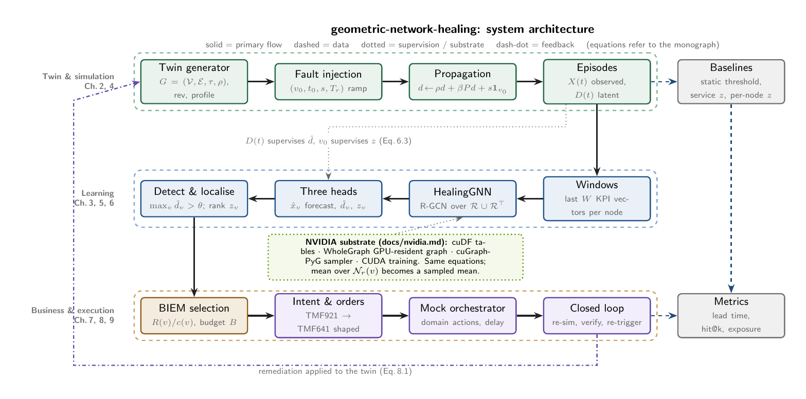
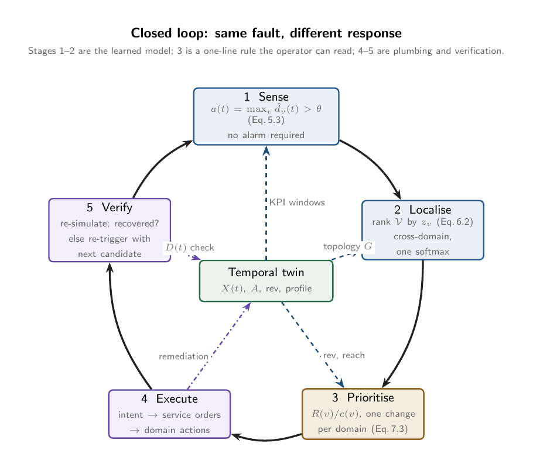

# Geometric Network Healing

**Root cause as the support of a residual. Solve the equations instead of learning them.**

I build network root-cause methods that solve the equations instead of learning them. On a network
whose propagation operator is known or identifiable, the root cause is the support of a residual:
apply the operator to the degradation field and read where it is not zero. With zero learned
parameters this matches a 241k-parameter graph network on detection, false alarms and root cause,
and the explanation it gives an operator is the equation rather than an attention weight. I ran
five experiments designed to separate the two and published all of them, including the one where
the learned model wins. I have a lab with a real 5G core and RAN on Intel Xeon 6, and what I need
is one month of real topology and telemetry to find out whether this survives contact with a
production network.

```
d(t+1) - M d(t)  =  s(t)        zero everywhere except the origin
M = rho*I + sum_r beta_r P_r    the operator, couplings declared in the ontology
```

Start here: **[docs/the-method.md](docs/the-method.md)**, the method in one page, including what
is proven, what is measured, and what is still open.



## The position

Learning should be the residual, not the default. Write down what is already known. The topology
is known. The way a fault spreads is known, or identifiable from unlabelled telemetry. Put that in
an operator, and the only thing left to learn is whatever the operator fails to explain.

This repository tests that claim rather than asserting it. It contains a full relational graph
network of the kind the industry now deploys for this task, trained on simulated incidents, and it
contains a solver with no parameters at all. Both are run on the same episodes with the same
calibration, and the comparison is reported in both directions.

| | trained graph network | the read-off |
|---|---|---|
| parameters learned | 241,222 | **0** |
| labelled incidents needed | yes | **none** |
| detection rate, false alarms | 1.00, zero | 1.00, zero |
| root cause hit@1 | 1.00 | 1.00 |
| explanation given | attention over a traversal | the equation itself |
| when the physics are wrong | **more robust** | degrades, see E6 |

The last row is not a footnote. The experiment designed to embarrass this method succeeded, and
it is in the paper.



## Four lines and one node

A short first-person paper. On a network with a known linear propagation operator, the root cause
is the support of a residual: apply the operator to the degradation field and read where it is not
zero. That read-off, with **zero learned parameters**, ties the 241k-parameter GNN on detection,
false alarms and root cause on the same episodes. Five further experiments try to separate the two
and are all reported: three ties, one where the read-off identifies the operator from unlabelled
telemetry, and one where the GNN is the more robust method under misspecified physics. The paper
ends with what one person needs next.

**[docs/flatness/four_lines_one_node.pdf](docs/flatness/four_lines_one_node.pdf)** (`make paper`; the solver is `baselines/flatness.py`).

## Results

<!-- RESULTS:START -->
Twin: 74 nodes, 130 edges. Fault episodes: 32, nominal: 8. Runtime 647.1 s.

| metric | value |
|---|---|
| detection rate, GNN | 1.00 |
| detection rate, static threshold | 1.00 |
| detection rate, service-layer z-score (calibrated z=4.1 / textbook z=3) | 0.00 / 0.31 |
| detection rate, per-node z-score (calibrated z=8.0 / textbook z=3) | 0.00 / 1.00 |
| false alarms on 8 nominal episodes: GNN / threshold / service z cal. / service z=3 / node z cal. / node z=3 | 0 / 0 / 0 / 4 / 0 / 8 |
| pre-onset false alarms on 32 fault episodes: same order | 0 / 0 / 0 / 3 / 0 / 30 |
| mean detection delay after onset (steps): GNN / static threshold | 22.9 / 32.6 |
| mean detection delay after onset (steps): service z cal. / service z=3 / node z cal. / node z=3 | nan / 56.2 / nan / 9.6 |
| mean lead time of GNN vs static threshold (steps, where it fired) | 9.8 |
| mean lead time of GNN vs service z (calibrated / z=3) | nan / 32.0 |
| mean lead time of GNN vs per-node z (calibrated / z=3) | nan / -13.3 |
| healed within 3 verify-and-re-trigger cycles | 1.00 |
| mean healing cycles | 1.00 |
| root cause hit@1 | 1.00 |
| root cause hit@3 | 1.00 |
| degraded nodes at static-alarm time (war-room set, mean) | 13.9 |
| triage reduction @3 (share of the war-room set a top-3 RCA list skips) | 0.35 |
| revenue-weighted exposure, GNN-timed healing | 328.3 |
| revenue-weighted exposure, threshold-timed healing | 573.1 |

## Flatness solve vs trained GNN (same episodes, same calibration, zero training)

| metric | trained GNN | flatness solve |
|---|---|---|
| detection rate | 1.00 | 1.00 |
| false alarms on nominal / pre-onset on fault episodes | 0 / 0 | 0 / 0 |
| mean detection delay after onset (steps) | 22.9 | 23.8 |
| mean lead time of flatness over GNN (steps, where GNN fired) | - | -1.0 |
| root cause hit@1 / hit@3 | 1.00 / 1.00 | 1.00 / 1.00 |
| top-1 agreement between the two | - | 1.00 |
| parameters learned | 241,222 | 0 |

## By fault type

| fault | n | delay GNN | delay flatness | delay thr | hit@1 GNN | hit@1 flatness |
|---|---|---|---|---|---|---|
| amf_signaling_storm | 7 | 27.9 | 31.7 | 45.0 | 1.00 | 1.00 |
| fiber_degrade | 7 | 22.7 | 23.0 | 28.6 | 1.00 | 1.00 |
| router_congestion | 7 | 22.3 | 23.6 | 32.3 | 1.00 | 1.00 |
| sleeping_cell | 8 | 18.5 | 17.1 | 25.4 | 1.00 | 1.00 |
| upf_overload | 3 | 24.7 | 26.0 | 33.3 | 1.00 | 1.00 |

*(CPU, fixed seed; regenerate with `make pipeline`.)*
<!-- RESULTS:END -->

## First contact with real telemetry

[`experiments/oberon_live/`](experiments/oberon_live/) is the first test against data nobody
generated for the purpose: a live five-plane 5G stack, real Thanos telemetry, a real injected
fault. **The method found nothing, and nothing was there to find.** The O-RU, O-CU and AMF in
that stack transmit zero bytes; they are placeholders sharing one container image, so no
degradation can propagate between them. Strong lagged correlation appears on 0.0% of the
modelled edges.

The method reported no clear origin, which is correct, and that is the first evidence its null
case is honest on data not constructed here.

The experiment produced a tool worth more than the result:
[`precondition.py`](experiments/oberon_live/precondition.py) tests whether a network satisfies
the method's assumption at all, from healthy telemetry alone, before anything is deployed.
It passes the synthetic control at 2.5x lift and fails the live stack at p = 1.0.

## The full record

[`docs/build-log.md`](docs/build-log.md) is the audit trail: every experiment with its numbers,
every defect found and what was done about it, the two experiments this method loses, and an
explicit list of what is still open. It is written so someone who was not here can check the
work rather than take it on trust.

The honest summary at the top of that list: every number in this repository comes from a
simulator written for this repository. That is the gap that matters, and no amount of further
engineering closes it.

## Reproduce

```bash
git clone https://github.com/dkypuros/geometric-network-healing
cd geometric-network-healing
make setup        # uv venv, CPU PyTorch + PyTorch Geometric
make test         # 6 tests, incl. a numerical permutation-equivariance check on the model
make pipeline     # twin -> simulate -> baselines -> GNN -> detect -> RCA -> intent -> closed loop
cat results/results.md
make pdf          # the monograph (needs a TeX distribution)
```

On a CUDA 12 Linux host, `make setup-nvidia` adds the RAPIDS stack (cuGraph-PyG, WholeGraph,
cuDF). See [docs/nvidia.md](docs/nvidia.md) for what each piece replaces and an honest note on
what is and is not tested here.

## Deployment, state and coordination

The repo runs as one process with everything in memory, on purpose. What changes when the same
method runs as a service across many sites is written up in
**[docs/state-and-coordination.md](docs/state-and-coordination.md)**: which state must survive a
restart, which must be shared between concurrent healers, where Redis belongs and where it does
not, and the two-tier split between edge sites and the metro hub.

It also records four known gaps with links to the exact code, so a reviewer does not have to find
them. The sharpest one: the change-risk concurrency policy in
[`select_order()`](src/gnn_healing/intent/biem.py#L53) uses a per-process set, which is correct for
the single-loop experiment here and breaks the moment two sites heal at once.

## An on-premises service you can hand to someone

[`onprem/`](onprem/) packages the method as a deterministic root-cause service: one container,
numpy, a topology file, no model weights and no egress. On a 781-node RAN, Core and Transport
graph it locates the origin of **27 of 27 injected faults across 8 node types in 172 µs per
step**, and the explanation it returns is the residual itself, one number per node.

```bash
make onprem-demo      # inject a transport fault, find it, explain it
make onprem-serve     # the service on :8080
```

It is topology-agnostic: hand it any typed directed graph with couplings and it builds the
operator. It refuses a topology whose couplings would make faults amplify instead of attenuate.
See [onprem/readme.md](onprem/readme.md), which also states plainly what it does not do.

## The ontology is load-bearing

[`docs/ontology/network-healing.ttl`](docs/ontology/network-healing.ttl) is not documentation.
It declares a coupling on each of the nine propagation relations, and that coupling is the
per-relation term in the operator:

```
M = rho*I + sum over relations r of ( beta_r * P_r )
```

A fibre cut and a signalling storm do not propagate at the same strength, and the published
single-scalar operator cannot say so. Setting every coupling equal recovers it to floating-point
equality, which [a test asserts](tests/test_ontology.py), so the published numbers cannot move.

Experiment E7 in the paper is the payoff, and it overturned my own explanation of an earlier
failure. Fitted on the true field, the per-relation regression recovers every coupling
essentially exactly. A single scalar on the same clean data returns 0.0055 rather than an
average, because with the memory term free, least squares prefers to abandon the coupling
entirely than to average genuinely different ones.

```bash
make ontology     # the vocabulary and its couplings
make e7           # identify them from unlabelled telemetry
```

## What the deployed industry system actually does

[`docs/what-the-demo-shows.md`](docs/what-the-demo-shows.md) reads the award-winning Catalyst
system off its own running UI rather than off its slides, and corrects my earlier write-up in
three places. The graph model does anomaly detection and reports `Primary origin: unknown`; root
cause comes from a separate agent running thirteen tools including z-scores and a topology walk.
The deployed twin is 1,367 nodes, not operator scale. And in the recorded run the business
ranking showed placeholder values while the orchestration engine was mocked, both disclosed by
the system itself.

It also compares the two ontologies, and that comparison is the most useful thing on the page.
Their business vocabulary and ours describe different layers: theirs says which fault to heal
first, ours says how a fault spreads. Theirs has no coupling term at all.

## Running it on real Intel silicon

[`deploy/oberon/`](deploy/oberon/) deploys the whole thing as a single Kubernetes Job to a
bare-metal Single Node OpenShift cluster with an Intel Xeon 6 (Granite Rapids), 256 vCPU,
503 GiB and AMX matrix extensions, and **no GPU**. That is the configuration this method is
argued to suit, so it is the one worth measuring on.

```bash
oc login https://api.<your-cluster> -u <user> \
    --certificate-authority=$HOME/.kube/oberon-combined-ca.crt
./deploy/oberon/run.sh
```

It installs nothing into the cluster beyond that one Job, and
[`scripts/oberon_bench.py`](scripts/oberon_bench.py) runs anywhere, not just there:
thread scaling, bfloat16 against float32 to see whether AMX engages, size scaling until the
dense covariance becomes the wall, and a check that the published numbers reproduce on
different silicon. Predictions are written down in the
[deploy README](deploy/oberon/readme.md) before the run so the result can contradict them.

## Layout

```
src/gnn_healing/
  twin/           Ch. 2  heterogeneous directed graph, synthetic generator, revenue + profiles
  sim/            Ch. 4  fault catalogue, directed diffusion, episodes with ground truth
  baselines/      Ch. 5  static threshold, service-layer z-score trigger, per-node z-score
  gnn/            Ch. 3,5,6  HealingGNN (R-GCN over R u R^T), training, detection, RCA, NVIDIA adapter
  intent/         Ch. 7  revenue at risk, budgeted selection, TMF921-shaped intent
  orchestration/  Ch. 8  TMF641-shaped orders, mock orchestrator, closed loop, re-trigger
  evaluation/     Ch. 9  lead time, hit@k, triage reduction, exposure
  cli.py                 gnn-healing pipeline | twin | backend
docs/what-the-demo-shows.md   the deployed industry system, read off its own UI
experiments/oberon_live/   first contact with real telemetry, and the precondition check
docs/build-log.md the full record: every measurement, every defect found, everything open
docs/the-method.md   the method in one page: proven, measured, and still open
docs/math/        the monograph (LaTeX, PDF committed)
docs/design/      TikZ architecture diagrams (source + PNG)
docs/flatness/    "One Node": the read-off vs the trained GNN, experiments E1-E6
docs/ontology/    the relation vocabulary and its couplings, in Turtle
docs/nvidia.md    the accelerated path
docs/state-and-coordination.md   deployment state, where Redis fits, known gaps
onprem/           deterministic root-cause service: container, API, OpenShift manifests
deploy/oberon/    one Job to run all of this on Intel Xeon 6 with AMX, no GPU
scripts/          oberon_bench.py, flatness_experiments.py, results renderers
docs/industry-comparison.md   how this relates to a 2026 TM Forum Catalyst of the same shape
tests/            twin invariants, propagation stability, model equivariance, intent ordering
```

## What this is not

Not a real network: the twin and fault model are deliberately simple and are the first things to
replace with your topology and incident history. Not a standards implementation: intents and
orders follow TMF921/TMF641 field shapes so a real orchestrator can be swapped in, but no
conformance is claimed. Not a scale result: the NVIDIA path is documented and import-guarded, and
the public release was tested on a machine without a GPU.

## License

Apache-2.0.
